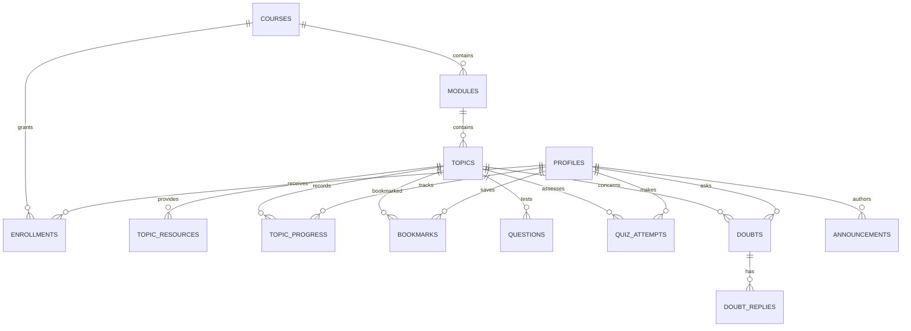

# Shahil Academy

A full-stack Learning Management System built with React, TypeScript, Vite, FastAPI, and SQLAlchemy. The API uses PostgreSQL in production and can use SQLite for local development.

## Architecture

```text
Browser (React)
  ├── Public pages: catalog, course details, policies
  └── Student/Admin portals
          │ Backend JWT (Bearer)
          ▼
FastAPI /api/v1 ── verified backend JWT ── role from profiles table
          │
          ▼
SQLAlchemy ── PostgreSQL (Supabase) / SQLite (local)
```

Admin roles are stored in the database and are never accepted from public registration or browser-supplied role claims. The backend enforces enrollment, content publication, ownership, quiz grading, and admin authorization.

## Folder structure

```text
frontend/       React application, routing, forms, and API client
backend/        FastAPI application, data models, migrations, and tests
docs/           API, security, database, and deployment documentation
```

## Database relationship overview



## Routes and screens

- Public: `/`, `/courses`, `/courses/:slug`, `/about`, `/contact`, `/privacy`, `/terms`
- Auth: `/login`, `/register`, `/forgot-password`, `/reset-password`
- Student: `/student/dashboard`, `/student/courses`, `/student/courses/:courseId`, `/student/learn/:topicId`, `/student/doubts`, `/student/announcements`, `/student/profile`
- Admin: `/admin/dashboard`, `/admin/courses`, `/admin/modules`, `/admin/topics`, `/admin/resources`, `/admin/questions`, `/admin/students`, `/admin/enrollments`, `/admin/doubts`, `/admin/announcements`, `/admin/reports`, `/admin/settings`

## Windows local development

For a detailed, numbered walkthrough, see [runs.md](runs.md). Supabase may be used as the PostgreSQL database provider; authentication is handled by the backend.

### Prerequisites

- Node.js 20 or newer and npm
- Python 3.11 or newer
- [uv](https://docs.astral.sh/uv/getting-started/installation/) for backend dependency and environment management
- PostgreSQL database for production; SQLite can be used locally

### Configure and run the backend

```powershell
cd backend
uv sync --extra dev
Copy-Item .env.example .env
uv run alembic upgrade head
uv run uvicorn app.main:app --reload
```

Set `DATABASE_URL` to a PostgreSQL connection string for a shared environment; the example uses a local SQLite database. Set `JWT_SECRET_KEY`, `JWT_ALGORITHM=HS256`, and `ACCESS_TOKEN_EXPIRE_MINUTES=60` in `backend/.env`. Keep the signing key private and use a strong random value in production. `/docs` is the interactive OpenAPI page and `/health` checks API availability.

### Configure and run the frontend

In a second PowerShell window:

```powershell
cd frontend
npm install
Copy-Item .env.example .env
npm run dev
```

Set `VITE_API_URL` in `frontend/.env`. Account registration and login use the backend; registration does not send an email or require email verification. Password recovery is not configured, so users who lose access must contact an administrator.

### Provisioning the first administrator

Register an account through the application, then use a trusted database connection to change only that account's `profiles.role` to `admin`. Never expose the database credential or JWT signing key in the frontend. A trusted operator action is required; public registration cannot set roles.

### Migrations and tests

```powershell
cd backend
uv run alembic upgrade head
uv run pytest
```

```powershell
cd frontend
npm run build
```

## Deployment

See [docs/deployment-guide.md](docs/deployment-guide.md) for the overview and [docs/host-frontend-backend.md](docs/host-frontend-backend.md) for step-by-step Vercel/Render hosting. Set secrets in the hosting providers, run Alembic as a deployment/release step, and configure production CORS origins. No credentials are included in this repository.

## Current configuration-dependent capabilities

- Account registration does not verify email ownership. Use a strong JWT secret and trusted admin provisioning.
- Private object storage uploads are intentionally unavailable until a bucket and server-side storage adapter are configured. External resource links work; the API does not claim local disk is persistent storage.
- Video playback is restricted to validated YouTube IDs; unlisted YouTube videos are not enrollment-protected.
- Payment processing is not enabled. No payment-success simulation or paid enrollment flow is present.
- Email delivery, notifications, and deployment must be configured with external providers.
